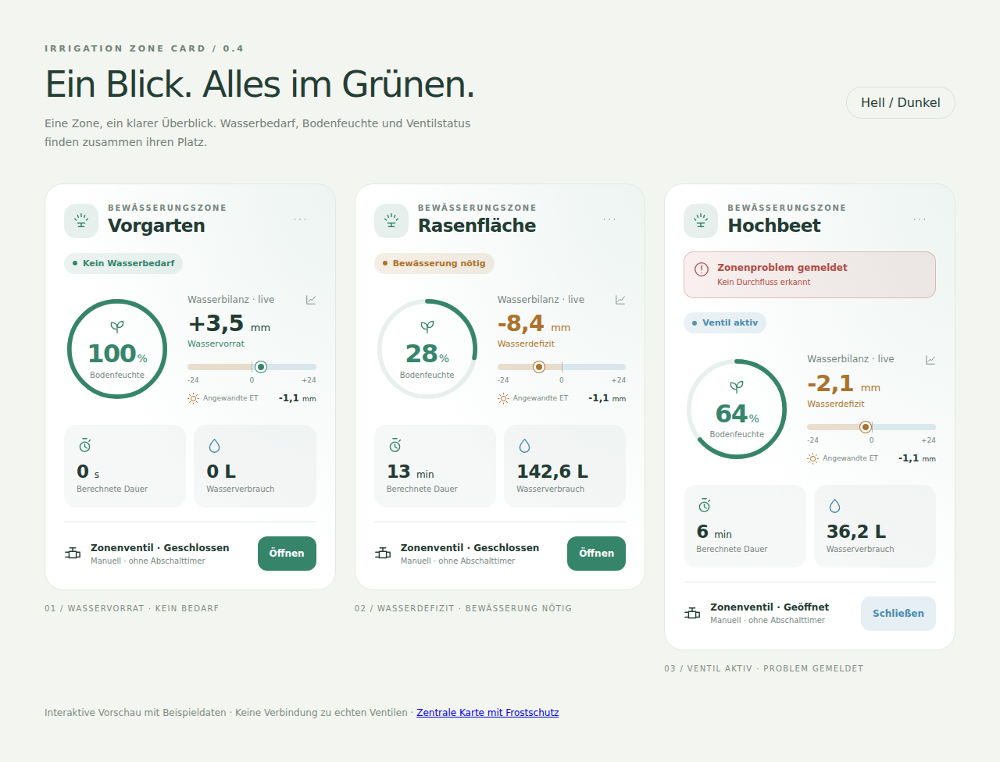
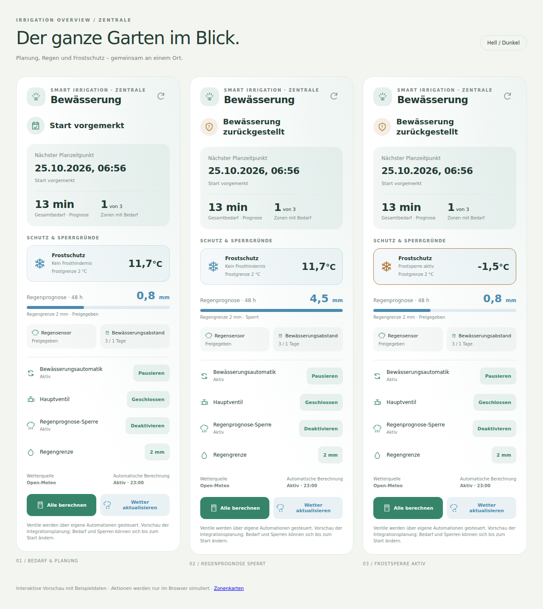
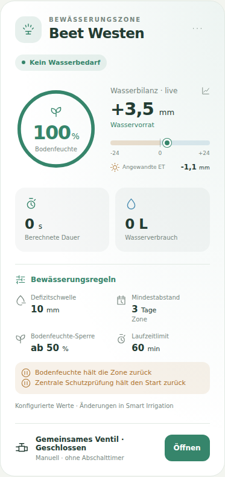

# Irrigation Zone Card

[English](README.md) | **Deutsch**

Eine Home-Assistant-Dashboardkarte für **eine Smart-Irrigation-Zone**. Bodenfeuchte als Ring, Wasserbilanz mit Nullpunkt, berechnete Bewässerungsdauer und Wasserverbrauch in einer ruhigen, kompakten Gartenoptik. Optional mit manuellem Zonenventil (`switch.*` oder `valve.*`).

Seit v0.3.0 enthält dieselbe HACS-Installation zusätzlich **Irrigation Overview**, eine zentrale Karte für Planung, Regen- und Frostschutz sowie integrationsweite Aktionen.



## Installation

### HACS

Die aktuelle Version ist auf der [Release-Seite](https://github.com/lweberru/ha_irrigation_zone_card/releases/latest) verfügbar.

1. In HACS unter **Benutzerdefinierte Repositories** `https://github.com/lweberru/ha_irrigation_zone_card` hinzufügen, Typ **Dashboard**.
2. **Irrigation Zone Card** herunterladen.
3. Falls HACS die Ressource nicht automatisch einträgt: unter **Einstellungen → Dashboards → Ressourcen** `/hacsfiles/ha_irrigation_zone_card/ha_irrigation_zone_card.js` als **JavaScript-Modul** hinzufügen. Ressourcen sind im erweiterten Benutzermodus sichtbar.
4. Browser neu laden. Im Kartenwähler nach **Irrigation Zone** suchen oder die YAML-Konfiguration unten verwenden.

Das Repository liefert die fertige Einzeldatei in `dist/ha_irrigation_zone_card.js`; Home Assistant benötigt weder npm noch zusätzliche Karten. Dateiname und Repo-Struktur folgen den [HACS-Anforderungen](https://www.hacs.xyz/docs/publish/plugin/). Dies ist ein Custom Repository, keine Aufnahme in den HACS-Standardkatalog.

### Manuell / lokale Entwicklung

`dist/ha_irrigation_zone_card.js` nach `<HA-Konfigurationsordner>/www/ha_irrigation_zone_card.js` kopieren und `/local/ha_irrigation_zone_card.js?v=0.5.0` als JavaScript-Modul in den Dashboard-Ressourcen registrieren. Bei Updates den Versionsparameter ändern und den Browser neu laden. Keine `.storage`-Dateien bearbeiten.

## Zentrale Karte: Irrigation Overview



Nach dem HACS-Update den Browser neu laden und im Kartenwähler **Irrigation Overview** auswählen. Für die automatische Zuordnung genügt:

```yaml
type: custom:irrigation-overview-card
```

Die Karte zeigt zentrale Daten aus Smart Irrigation:

- Gesamtstatus und nächster Planzeitpunkt, einschließlich der Unterscheidung zwischen vorgemerkt und nicht vorgemerkt.
- Berechneter oder prognostizierter Gesamtbedarf und Anzahl der Zonen mit Bedarf, ohne einzelne Zonenlisten zu duplizieren.
- **Frostschutz als eigener Bereich:** gemeldete Temperatur und Frostgrenze in der Einheit der Integration, aktive Frostsperre, ausgeschalteter Schutz oder fehlender Messwert.
- Regenprognose für den gemeldeten Zeitraum mit Vergleich zur Regengrenze; weitere aktive Prüfungen wie Regensensor, Wind, Bewässerungsabstand und Bodenfeuchte.
- Wetterquelle und automatische Berechnung mit Berechnungszeit.
- **Alle berechnen** und **Wetter aktualisieren** über die nativen globalen Button-Entitäten. Regenprognose-Sperre und Regengrenze werden ebenfalls automatisch anhand stabiler interner Kennungen zugeordnet.

Eine eigene Automation und das Hauptventil sind optional. Im Editor tatsächliche Entity-IDs auswählen:

```yaml
type: custom:irrigation-overview-card
name: Gartensteuerung
automation_entity: automation.meine_bewasserung
main_valve_entity: switch.mein_hauptventil
```

Die eigene Automation kann über die Karte aktiviert oder pausiert werden. Das Hauptventil zeigt seinen Zustand; ein Klick öffnet den nativen HA-Detaildialog. Die Regengrenze lässt sich ebenfalls über den Detaildialog bearbeiten. Der Schalter für die Regenprognose-Sperre deaktiviert bzw. aktiviert den Schutz dauerhaft bis zur nächsten Änderung. Frost- und Windgrenzen werden aus den Schutzprüfungen übernommen; deren Konfiguration erfolgt weiterhin in Smart Irrigation.

**Planung ist kein garantierter Lauf:** Die Vorschau stammt aus der Integrationsplanung. Ein Startzeitpunkt allein bedeutet nicht, dass der Start vorgemerkt ist. Eigene Automationen können andere Regeln anwenden als die Vorschau. Ohne zugewiesene `automation_entity` kennt die Karte deren Aktivierungszustand nicht; sie errät keine Automation. Direkte Ventilläufe werden nur anhand der von Smart Irrigation gemeldeten aktiven Läufe als Bewässerung aktiv dargestellt. Die Karte startet selbst keinen Bewässerungslauf.

Der Frostbereich erfindet keine eigene Frostgrenze. Er zeigt die Entscheidung aus `skip_preview` an. Ein fehlender Temperaturwert wird ausdrücklich als unbekannt dargestellt. Ein ausgeschalteter Frostschutz erhält einen entsprechenden Hinweis, keine Freigabeanzeige.

| Feld | Standard | Bedeutung |
| --- | --- | --- |
| `name` | `Bewässerung` / `Irrigation` | Titel |
| `icon` | `mdi:sprinkler-variant` | Symbol |
| `automation_entity` | optional | Eigene `automation.*`; Zustand und Aktivieren/Pausieren |
| `main_valve_entity` | optional | `switch.*` oder `valve.*`; Zustand und HA-Detaildialog |
| `calculate_entity` | automatisch | Globale `button.*`-Entität für alle Berechnungen |
| `update_weather_entity` | automatisch | Globale `button.*`-Entität für Wetteraktualisierung |
| `precipitation_switch_entity` | automatisch | `switch.*` für die Regenprognose-Sperre |
| `precipitation_threshold_entity` | automatisch | `number.*` für die Regengrenze |
| `show_actions` | `true` | Direkte Service-Schaltflächen anzeigen; HA-Detaildialoge bleiben erreichbar |
| `language` | `auto` | `auto`, `de`, `en` |

Voraussetzung sind die Smart-Irrigation-Endpunkte `smart_irrigation/info`, `smart_irrigation/config` und `smart_irrigation/zones` sowie Zugriff auf das Entity-Registry. Geprüft mit v2026.10.8. Die Karte lädt die Planung bei Integrationsänderungen, relevanten Zustandsänderungen, Wiederverbindung und einmal pro Minute nach, solange sie angezeigt wird. Mehrere zentrale Karten teilen sich die Planungsabfragen; mit den Zonenkarten teilen sie sich die Zonen-/Registry-Abfragen. Abonnements und Timer werden beim Entfernen aufgeräumt.

Datum und Uhrzeit verwenden die HA-Zeitzone. Nicht verfügbare API-Daten werden als unbekannt dargestellt; berechnete Werte werden bei Fehlern nicht durch 0 ersetzt. Fehlende globale Aktions-Entitäten deaktivieren die jeweilige Schaltfläche. Noch nie gedrückte Buttons mit HA-Zustand `unknown` bleiben bedienbar.

## Einfach einrichten: Zone auswählen

Im visuellen Karteneditor unter **Smart-Irrigation-Zone** die gewünschte Zone auswählen. Die Karte übernimmt automatisch:

- Zonenname, berechnete Dauer, Bewässerungsbedarf, Live-Wasserbilanz und Wasserverbrauch.
- Angewandte ET und Zonenproblemstatus einschließlich gemeldeter Ursache.
- Den in Smart Irrigation hinterlegten Bodenfeuchtesensor (`soil_moisture_sensor`).
- Das verknüpfte Ventil (`linked_entity`), sofern es ein `switch` oder `valve` ist.

Die YAML-Konfiguration benötigt nur die interne Zonen-ID (auch `0` ist gültig):

```yaml
type: custom:irrigation-zone-card
zone: 0
```

Der Editor zeigt Namen und IDs zur Auswahl an. `zone` ist **keine Home-Assistant-Ortszone** und kein Zonenname. Die Karte liest die Smart-Irrigation-Zonen per `smart_irrigation/zones` und findet deren Sensoren über die stabilen `unique_id`-Kennungen im HA-Entity-Registry. Umbenannte Entity-IDs werden dadurch weiterhin zugeordnet; Namen oder Entity-Präfixe werden nicht geraten. Voraussetzung ist eine Smart-Irrigation-Version mit diesem Zonen-Endpunkt und den Kennungen `smart_irrigation_<id>_<Rolle>`, etwa die Version v2026.10.8, mit der die Funktion geprüft wurde.

Unter **Sensoren überschreiben (optional)** lassen sich einzelne Zuordnungen anpassen. Explizit eingetragene Entitäten haben Vorrang; für andere Felder bleibt die automatische Zuordnung aktiv. Ist kein Bodenfeuchtesensor oder Ventil in Smart Irrigation hinterlegt, entfällt dessen Anzeige bis zur manuellen Zuordnung. Mehrdeutige, deaktivierte oder nicht gefundene Berechnungssensoren erhalten einen Hinweis statt einer geratenen Zuordnung. API- oder Verbindungsfehler erscheinen ebenfalls in der Karte.

```yaml
type: custom:irrigation-zone-card
zone: 0
moisture_entity: sensor.mein_bodenfeuchtesensor # optionale Überschreibung
show_control: false # optional nur den Ventilzustand anzeigen
```

Ist dasselbe Ventil mehreren Zonen zugeordnet, kennzeichnet die Karte es als **Gemeinsames Ventil**. Ein manueller Schaltbefehl betrifft dieses gemeinsame Ventil. Die Auswahl einer Zone schafft keine unabhängige hydraulische Steuerung.

Ein Zonenwechsel im Editor löscht bisherige Sensorüberschreibungen und den eigenen Namen, damit die neue Zone ihre Zuordnungen erhält. Danach können neue Überschreibungen gesetzt werden. Manuelle Konfiguration ohne `zone` bleibt vollständig unterstützt; unter **Manuell konfigurieren** sind die Einzelfelder aufgeklappt. Änderungen an den Smart-Irrigation-Zonen und im Entity-Registry werden bei verbundenem Dashboard nachgeladen. Mehrere Karten teilen sich die Lesezugriffe und geben ihre Abonnements beim Entfernen frei. Falls eine ältere Integration Änderungsabonnements nicht unterstützt, die Ansicht nach einer Änderung neu laden.

## Beispiel: Vorgarten

```yaml
type: custom:irrigation-zone-card
name: Vorgarten
entity: sensor.smart_irrigation_vorgarten
irrigation_needed_entity: binary_sensor.smart_irrigation_vorgarten_irrigation_needed
bucket_entity: sensor.smart_irrigation_vorgarten_live_bucket
water_used_entity: sensor.smart_irrigation_vorgarten_water_used
moisture_entity: sensor.vorgarten_pflanzen_vorgarten_bodenfeuchtigkeit
et_entity: sensor.smart_irrigation_vorgarten_et_value
problem_entity: binary_sensor.smart_irrigation_vorgarten_problem
```

Die Sensor-IDs im Beispiel an die eigene Zone anpassen. Optional eine Ventil-Entität ergänzen:

```yaml
valve_entity: switch.mein_zonenventil # alternativ valve.mein_zonenventil
show_control: true
confirm_open: true
```

Alle Felder sind im visuellen Karteneditor bearbeitbar. Der Kartenwähler schlägt bei verfügbarer Zonen-ID die automatische Zonen-Konfiguration vor, andernfalls eine manuelle Konfiguration. Bestehende Karten aus v0.1.0 funktionieren unverändert weiter. Für eine Umstellung im Editor die Zone auswählen oder in YAML die bisherigen Einzelzuordnungen durch `zone` ersetzen.

## Optionen

| Feld | Standard | Bedeutung |
| --- | --- | --- |
| `zone` | optional | Smart-Irrigation-Zonen-ID; automatische Zuordnung aktivieren |
| `entity` | ohne `zone` erforderlich | Smart-Irrigation-Dauersensor; mit `zone` optionale Überschreibung |
| `name` | Zonenname bzw. Anzeigename des Sensors | Name der Zone |
| `icon` | `mdi:sprinkler-variant` | Symbol im Kopf |
| `irrigation_needed_entity` | optional | `binary_sensor`: `on` = Bedarf, `off` = kein Bedarf |
| `bucket_entity` | optional | Live-Wasserbilanz-Sensor; mit `zone` automatisch zugeordnet |
| `moisture_entity` | optional | Bodenfeuchte; Ringfüllung nur bei Einheit `%` |
| `water_used_entity` | optional | Verbrauchssensor mit dessen Einheit und Bezugszeitraum |
| `et_entity` | optional / mit `zone` automatisch | Sensor für angewandte ET (`et_value`) |
| `problem_entity` | optional / mit `zone` automatisch | `binary_sensor` für Zonenprobleme (`problem`) |
| `valve_entity` | optional | `switch.*` oder `valve.*` |
| `show_rules` | `true` | Bewässerungsregeln und gemeldete Sperren bei Konfiguration mit `zone` anzeigen |
| `show_control` | `true` | Manuelle Schaltfläche am Ventil anzeigen |
| `confirm_open` | `true` | Bestätigung vor manuellem Öffnen |
| `bucket_min` | negatives Skalenmaximum | Linkes Skalenende, kleiner als 0 |
| `bucket_max` | `maximum_bucket` am Dauersensor, sonst `25` | Rechtes Skalenende, größer als 0, in der Einheit der Wasserbilanz |
| `language` | `auto` | `auto`, `de` oder `en`; andere HA-Sprachen erhalten englische Texte |

Zahlen verwenden die Home-Assistant-Benutzersprache. Helle/dunkle Themes und reduzierte Bewegung werden berücksichtigt. In Sections-Ansichten belegt die Karte standardmäßig 12 Spalten und automatische Höhe; die Breite ist über das HA-Layout anpassbar. Dauer, Verbrauch, Bodenfeuchte und angewandte ET öffnen per Klick ihren HA-Detaildialog. Die Wasserbilanz ist über Wert oder Skala anklickbar; ein Diagrammsymbol weist auf den verfügbaren Verlauf hin. Der Verlauf im nativen HA-Sensordialog hängt von den gespeicherten Recorder-Daten ab. Die Karte führt keinen eigenen Verlaufsspeicher und ändert keine Recorder-Einstellungen. Die Wasserbilanz lässt sich auch per Tastatur (Enter/Leertaste) öffnen.

### Bedeutung der Anzeigen

- **Wasserbilanz:** Der Nullpunkt trennt Defizit (negativ) und Vorrat (positiv). Der Marker wird auf die Skala begrenzt, der Zahlenwert bleibt unverändert. Die Bilanz ist keine gemessene Bodenfeuchte. `bucket_min`/`bucket_max` ändern nur die Visualisierung, keine Bewässerungseinstellungen. Skala und Sensor müssen dieselbe Einheit verwenden; die Karte rechnet keine Längenmaße um.
- **Bodenfeuchte:** Der Ring zeigt den Sensorwert, ohne pauschale Gut-/Schlecht-Grenzen für unterschiedliche Böden zu erfinden. Außerhalb 0–100 % wird nur die Ringfüllung begrenzt. Andere Einheiten werden als Zahl ohne Füllung angezeigt.
- **Dauer:** Berechnete Empfehlung, kein Countdown. Sekunden, Minuten und Stunden werden lesbar formatiert; unbekannte Einheiten bleiben erhalten.
- **Wasserverbrauch:** Der Wert des Sensors, kein errechneter Tagesverbrauch. Den Bezugszeitraum bestimmt die verwendete Entität.
- **Angewandte ET:** Eine kleine Kennzahl bei der Bilanz mit unverändertem Vorzeichen und der Einheit des Sensors. Ohne Bilanzsensor erscheint sie als eigene Zeile. Die Karte übernimmt den von Smart Irrigation als `et_value` veröffentlichten Wert, der auf dem gespeicherten Berechnungsdelta beruht. Sie interpretiert ihn nicht als reine Verdunstung, berechnet keinen Tageswert daraus und macht daraus keinen Live-Zähler. Der Detaildialog zeigt den zugehörigen Sensor. Fehlende Werte erscheinen als `—`, auch bei automatisch erwarteten, aber nicht gefundenen ET-Sensoren.
- **Zonenproblem:** Bei `on` erscheint oberhalb des Bedarfsstatus ein auffälliger Warnhinweis. Bekannte Ursachen aus `reason` werden übersetzt (`valve_did_not_open`, `valve_did_not_close`, `no_flow`), andere Meldungen als sicher kodierter Text angezeigt. Ein Klick öffnet den Problemsensor. Ohne Ursache verweist die Karte auf dessen Details. Bei `off` entfällt der Warnbereich; fehlende, unbekannte oder nicht verfügbare Problemsensoren werden ausdrücklich als **Problemstatus unbekannt** angezeigt. Bei manueller Konfiguration ohne `problem_entity` entfällt die Funktion. Die Integration kann ein gemeldetes Problem bis zu einem erfolgreichen Lauf speichern; die Karte quittiert oder löscht es nicht. Ventilzustand und Schließen bleiben auch bei einer Warnung sichtbar.
- **Status:** Ein aktives oder bewegtes Ventil hat Vorrang, danach gilt der Bedarfssensor. Ohne bekannten Bedarf zeigt die Karte „Wasserbedarf unbekannt“. „Ventil aktiv“ zeigt den gemeldeten Ventilzustand, keinen gemessenen Wasserfluss.
- **Fehlende Daten:** `unknown`, `unavailable` und fehlende Entitäten erscheinen als `—` mit Hinweis. Sie werden nicht in 0 umgewandelt.

### Bewässerungsregeln

Mit `zone` liest die Karte auch die konfigurierten Regeln aus Smart Irrigation: **Defizitschwelle**, **Mindestabstand**, **Bodenfeuchte-Sperre** und **Laufzeitlimit**. Der Mindestabstand wird als zoneneigener oder global geerbter Wert gekennzeichnet. `0` Tage bleibt ein expliziter Wert ohne Abstandsregel; fehlende Daten erscheinen als unbekannt. Die Defizitschwelle ist eine Startschwelle und kein Zielwert für die Wasserbilanz. Saisonale Anpassungen können die tatsächlich angewandten Werte verändern.



Die Karte zeigt zusätzlich die von der Integration zuletzt gemeldeten Sperren für genau diese Zone (Bodenfeuchte und Mindestabstand) sowie einen Hinweis auf zentrale Schutzsperren. Sie berechnet keine eigene Startfreigabe aus Sensorwerten oder Datumsangaben. Ein fehlender Schutzstatus wird ausdrücklich angezeigt. Eigene Automationen müssen diese Regeln selbst berücksichtigen.

Die Werte werden bei Konfigurationsänderungen neu gelesen; die Schutzvorschau aktualisiert sich zusätzlich einmal pro Minute. Alle Zonen- und Übersichtskarten teilen sich diese Systemabfragen. Einstellungen werden weiterhin in Smart Irrigation geändert. Manuelle Sensorzuweisungen ohne `zone` erhalten keine vermuteten Regeln; eine Zone kann mit manuellen Sensorüberschreibungen kombiniert werden. Mit `show_rules: false` oder im visuellen Editor lässt sich der Bereich ausblenden.

### Ventilsteuerung

Die Karte ruft `switch.turn_on`/`switch.turn_off` beziehungsweise `valve.open_valve`/`valve.close_valve` für genau die konfigurierte Entität auf. Bei Valves berücksichtigt sie die gemeldeten OPEN-/CLOSE-Funktionen. Bei unbekanntem Zustand oder bewegtem Ventil ist die Schaltfläche deaktiviert. Fehler werden in der Karte angezeigt; der Zustand kommt weiter von Home Assistant.

**Manuelles Öffnen startet keinen Abschalttimer und keine Smart-Irrigation-Automation.** Ein geöffnetes Ventil muss manuell oder durch eine bestehende Automation geschlossen werden. Daher gibt es standardmäßig eine Bestätigung beim Öffnen. Schließen ist direkt möglich. Mit `show_control: false` wird nur der Zustand dargestellt. Die Karte schreibt keine Smart-Irrigation-Bilanz zurück und verändert keine Automationen.

## Entwicklung und Vorschau

Node.js 22 oder neuer:

```bash
npm ci
npm run build
npm run dev
# http://localhost:5173
```

Die lokale Vorschau zeigt drei Zonen mit **Beispieldaten**, darunter die bei der Entwicklung gelesenen Vorgartenwerte (3,52 mm, 100 %, 0 s). Buttons simulieren Zustandswechsel im Browser. Es werden keine Home-Assistant-Zugangsdaten benötigt und keine realen Ventile geschaltet. Symbole in der Vorschau sind lokale Platzhalter; im Dashboard zeichnet Home Assistant seine eigenen MDI-Icons. Der visuelle Editor verwendet das native `ha-form` und wird in Home Assistant dargestellt.

Die zentrale Vorschau unter `http://localhost:5173/demo/overview.html` zeigt geplanten Bedarf, Regensperre und Frostsperre mit Beispieldaten. Auch dort werden alle Aktionen ausschließlich im Browser simuliert.

```bash
npx playwright install chromium
npm run check
```

Prüft Konfiguration, Einheiten, Statuslogik, Skalen und Aktoraktionen sowie Darstellung, Bestätigungsdialog, Serviceaufrufe, Fehler, HTML-Escaping, Detaildialog-Ereignis, Editor-Konfigurationsereignis und mobile Breite im Browser. Screenshots unter `test-results/`. Die Browserprüfungen verwenden simulierte HA-Objekte; eine Prüfung im echten HA-Frontend bleibt für eine Installation erforderlich.

Zusätzlich werden Zonen-ID `0`, stabile Zuordnung bei umbenannten Entity-IDs, manuelle Überschreibungen, Zonenwechsel, gemeinsame Ventile, geteilte Lesezugriffe, Aufräumen der Abonnements und API-Fehler geprüft. Die Zuordnung aller drei Beispielzonen wurde mit echten API-Antworten validiert, ohne Ventile zu schalten.

Die zentrale Karte ergänzt Prüfungen für Planungsstatus, eigene Automationen, API-Ausfälle, Frostsperre, fehlende Temperaturwerte, ausgeschalteten Frostschutz, Regenwerte, native globale Buttons, Servicefehler, Detaildialoge, Zeitzonen und mobile Darstellung. Weitere Prüfungen decken ET-/Problemzuordnung, Live-Änderungen, Vorzeichen, sichere Meldungstexte, unbekannte Problemzustände und die klickbare Wasserbilanz einschließlich Tastaturbedienung ab. Insgesamt 24 Logiktests und 23 Browserprüfungen. Auch Zuordnung und Schutzdaten wurden mit echten API-Antworten geprüft; dabei wurden keine Aktionen auf dem echten System ausgeführt.

`src/` enthält den Quellcode; `dist/` wird mit eingecheckt, damit HACS auch ohne GitHub-Release installieren kann. Nach Änderungen `npm run build` ausführen. Der Build enthält alle Laufzeitdateien ohne CDN-Abhängigkeiten. CI prüft auch, dass der Distributable aktuell ist. GitHub-Veröffentlichung und Installation auf einem HA-System sind separate Schritte.

## Referenzen

- [Home Assistant: Custom Cards](https://contributors.home-assistant.io/frontend/custom-ui/card/)
- [Home Assistant: Editor und Kartenwähler](https://contributors.home-assistant.io/frontend/custom-ui/card-editor/)
- [Home Assistant: Valve-Zustände und Aktionen](https://www.home-assistant.io/integrations/valve/)
- [HACS: Dashboard-Repository](https://www.hacs.xyz/docs/publish/plugin/)
- [Smart Irrigation: Zonen-WebSocket](https://github.com/altmenorg/HAsmartirrigation/blob/master/custom_components/smart_irrigation/websockets.py)
- [Smart Irrigation: stabile Sensor-Kennungen](https://github.com/altmenorg/HAsmartirrigation/blob/master/custom_components/smart_irrigation/sensor.py)
- [Smart Irrigation: Problemstatus und Ursache](https://github.com/altmenorg/HAsmartirrigation/blob/master/custom_components/smart_irrigation/binary_sensor.py)

MIT-Lizenz.
